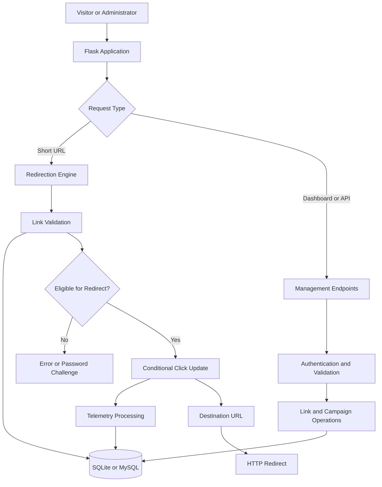
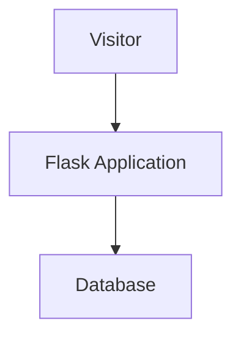

# 🔗 LinkPulse — Intelligent Link Management & Telemetry Engine

[](https://www.python.org/)
[](https://flask.palletsprojects.com/)
[](https://www.sqlite.org/)
[](LICENSE)
[](#key-features)

**LinkPulse** is an intelligent URL management, routing, and analytics platform engineered for efficient redirection, secure link governance, and comprehensive traffic telemetry.

Combining a high-performance Flask backend with a modern glassmorphic dashboard, LinkPulse provides centralized short-link management, atomic click-limit enforcement, destination validation, password-protected links, dynamic QR generation, campaign attribution, and bot-filtered analytics.

---

## Table of Contents

- [Overview](#overview)
- [Project Directory Structure](#project-directory-structure)
- [Key Features](#key-features)
- [System Architecture](#system-architecture)
- [Redirect Lifecycle and Flow](#redirect-lifecycle-and-flow)
- [Security and Governance](#security-and-governance)
- [Technology Stack](#technology-stack)
- [Getting Started](#getting-started)
- [Configuration Reference](#configuration-reference)
- [API Reference](#api-reference)
- [Deployment Guide](#deployment-guide)
- [Testing and Troubleshooting](#testing-and-troubleshooting)
- [Future Roadmap](#future-roadmap)
- [License](#license)

---

## Overview

Traditional URL shorteners primarily focus on converting long URLs into compact links. LinkPulse extends this functionality with security controls, campaign organization, traffic analytics, and comprehensive link lifecycle management.

The platform provides an administrative workspace for creating, organizing, monitoring, and managing short links while applying validation and request controls to help mitigate redirect abuse.

### Project Objectives

- Deliver efficient short-link redirection.
- Provide centralized link and campaign management.
- Enforce configured click limits and expiration policies.
- Protect selected destinations using password verification.
- Analyze traffic patterns through interactive visualizations.
- Identify common automated clients for more useful analytics.
- Support QR generation and CSV-based data workflows.
- Provide a responsive interface with a modern glassmorphic design.

---

## Project Directory Structure

```text
LINKPULSE/
├── frontend/
│   ├── Group_Logo.png       # Application brand asset
│   ├── index.html           # Main telemetry dashboard
│   ├── login.html           # Authentication interface
│   └── style.css            # Glassmorphic UI design system
├── .env.example             # Environment configuration template
├── README.md                # Project documentation
├── app.py                   # Flask server, routing engine and API
├── config.py                # Environment configuration loader
├── database.py              # SQLite and MySQL database adapter
├── helpers.py               # Security utilities and helper functions
├── requirements.txt         # Python dependencies
└── LICENSE                  # MIT license, if included in the repository
```

The tree represents the documented project layout. Additional files, such as a `Procfile`, test directory, migration scripts, or deployment configuration, may be added as the project evolves.

---

## Key Features

### 1. High-Performance Redirection Engine

- **Low-Latency Redirection:** Lightweight Flask request handling and direct database operations designed for efficient redirects.
- **Atomic Click Capping:** Conditional SQL updates help prevent concurrent requests from exceeding configured click limits.
- **Password-Protected Links:** Require server-side password verification before granting access to protected destinations.
- **Instant Link Deactivation:** Disable links to stop subsequent redirects while retaining historical records where supported.
- **Scheduled Expiration:** Enforce configured expiration deadlines.
- **Link Lifecycle Management:** Create, update, search, activate, deactivate, and delete short links.
- **Seven-Character Aliases:** Generate compact Base62 short codes, subject to collision checks and retry handling.

### 2. Live Telemetry and Analytics

- **Seven-Day Click Trends:** Visualize rolling traffic patterns using chart views supported by the dashboard.
- **Device Intelligence:** Categorize supported traffic as mobile, tablet, or desktop.
- **Browser Detection:** Parse user-agent information to identify common browser families.
- **Geographic Insights:** Use the Cloudflare `CF-IPCountry` header with a configured fallback where available.
- **Bot and Crawler Filtering:** Identify common automated clients to improve human-traffic analytics.
- **Privacy-Aware Tracking:** Use salted SHA-256 hashes for IP-derived analytics identifiers rather than storing raw IP addresses for those identifiers.
- **Traffic Breakdown:** Review supported analytics summaries and categorical traffic distributions.

### 3. Campaign Attribution and Productivity

- **Campaign Grouping:** Organize short links into campaigns and review aggregated traffic metrics.
- **Dynamic QR Codes:** Generate QR codes in the browser and export them as PNG images.
- **Bulk CSV Import:** Import up to 2,500 links per batch with row-level validation feedback.
- **CSV Export:** Export link records in an Excel-compatible UTF-8 format with BOM encoding.
- **Click Simulator:** Test link behavior and observe analytics updates through the dashboard.

### 4. Modern Glassmorphic Interface

- Translucent surfaces and contemporary visual styling.
- Responsive dashboard layouts.
- Interactive traffic charts and management controls.
- Plus Jakarta Sans and JetBrains Mono typography.
- Dedicated login and dashboard interfaces.
- Organized link and campaign management workflows.

---

## System Architecture

LinkPulse uses a layered architecture that separates HTTP request handling, link validation, database operations, and telemetry processing.



### Core Components

| Component | Responsibility |
|---|---|
| `app.py` | Flask application, routing, and REST API endpoints |
| `config.py` | Environment-based configuration |
| `database.py` | Database connectivity and data operations |
| `helpers.py` | Validation, security utilities, user-agent parsing, and rate limiting |
| `frontend/index.html` | Main dashboard |
| `frontend/login.html` | Authentication interface |
| `frontend/style.css` | Responsive styling and glassmorphism design |
| `.env.example` | Example environment variables |
| `requirements.txt` | Python dependency declarations |

### Architectural Principles

- **Separation of concerns:** Keep routing, database access, configuration, and helper logic organized into separate modules.
- **Defensive validation:** Validate user input and destination URLs before accepting or redirecting requests.
- **Database consistency:** Use appropriate transactions and conditional updates for operations involving click limits.
- **Privacy awareness:** Minimize the storage of sensitive visitor information.
- **Operational flexibility:** Support SQLite for suitable deployments and MySQL-compatible databases where shared persistence is required.

---

## Redirect Lifecycle and Flow

A typical short-link request follows the lifecycle below.

1. **Request:** A visitor opens a short URL.
2. **Lookup:** The application retrieves the corresponding link record.
3. **Existence Check:** The application verifies that the requested alias exists.
4. **Status Validation:** The engine checks whether the link is active.
5. **Expiration Check:** The configured expiration deadline is evaluated.
6. **Access Control:** Protected links require successful password verification.
7. **Click-Limit Enforcement:** A conditional database update checks and increments the click count.
8. **Telemetry Processing:** The visit is evaluated for the supported analytics pipeline.
9. **Redirection:** An eligible visitor is redirected to the destination URL.

The exact order of database operations, password verification, and analytics processing depends on the implementation. The diagram represents the intended workflow rather than a guarantee about every internal execution detail.


## System Architecture

LinkPulse uses a layered architecture that separates request handling,
link validation, database operations, and telemetry processing.


## System Architecture


### Click-Limit Enforcement

A typical conditional SQL update follows this pattern:

```sql
UPDATE links
SET click_count = click_count + 1
WHERE id = ?
  AND is_active = 1
  AND (click_limit IS NULL OR click_count < click_limit);
```

This is an illustrative query. Adapt the table name, column names, placeholder syntax, and eligibility conditions to the actual schema.

The application should check the affected-row count to determine whether the update succeeded. The update must run with appropriate transaction handling, and eligibility checks must account for expiration, access restrictions, and other applicable policies.

---

## Security and Governance

LinkPulse incorporates defensive controls intended to reduce redirect abuse and protect administrative operations.

| Security Layer | Description |
|---|---|
| SSRF-Oriented Validation | Validates destination URLs and rejects prohibited hosts and address ranges according to configured rules |
| Private IP Protection | Checks for loopback, private, link-local, and other disallowed address ranges |
| Domain Blocklist | Blocks destinations matching configured prohibited-domain rules |
| Credential Validation | Rejects destination URLs containing embedded credentials |
| Atomic Click Limits | Uses conditional SQL updates to reduce concurrency-related limit violations |
| Rate Limiting | Applies request limits to help mitigate endpoint abuse |
| Password Protection | Verifies protected-link passwords on the server |
| Privacy-Aware Analytics | Uses salted hashing for IP-derived analytics identifiers |
| Secret Management | Supports environment-based application configuration |

### Short-Code Generation

LinkPulse uses seven-character Base62 aliases.

Base62 uses 62 possible characters per position. The theoretical number of seven-character combinations is:

\[
62^7 = 3{,}521{,}614{,}606{,}208
\]

Collision checks and retry handling help prevent duplicate aliases from being assigned.

This is the theoretical search space, not a measure of cryptographic security or a guarantee that aliases are unpredictable.

### Security Considerations

**URL validation alone is not sufficient to guarantee SSRF protection.**

For production deployments:

- Validate URL schemes and reject unsupported protocols.
- Reject embedded credentials in destination URLs.
- Resolve hostnames and validate the resulting IP addresses where appropriate.
- Account for DNS rebinding and changes in DNS resolution.
- Block prohibited IPv4 and IPv6 address ranges.
- Configure trusted proxy headers correctly.
- Apply rate limits to authentication and other sensitive endpoints.
- Protect session cookies and application secrets.
- Use secure password hashing and avoid plaintext credential storage.
- Keep dependencies updated and review security advisories.
- Avoid logging passwords, session tokens, and unnecessary visitor data.
- Test validation against alternative IP formats, redirects, and other bypass techniques.

If the application follows redirects from submitted URLs or fetches remote resources, additional destination checks are necessary at every relevant network request.

---

## Technology Stack

| Category | Technology |
|---|---|
| Backend | Python 3.10+, Flask 3.x |
| Security Utilities | Werkzeug and custom validation helpers |
| Database | SQLite, MySQL, MariaDB |
| Database Access | Custom database adapter |
| Frontend | HTML5, CSS3, Vanilla JavaScript ES6+ |
| UI Design | Glassmorphism and responsive CSS |
| QR Generation | QRCode.js |
| Analytics | JavaScript charting and user-agent parsing |
| Typography | Plus Jakarta Sans, JetBrains Mono |
| Configuration | Environment variables |
| Deployment | Python-compatible hosting platforms or Linux VPS |

The stack reflects the documented project design. Verify the actual dependencies and versions in `requirements.txt` before deploying.

---

## Getting Started

### Prerequisites

Install the following tools:

- Python 3.10 or higher
- pip
- Git
- A supported database, depending on the selected configuration

### 1. Clone the Repository

```bash
git clone https://github.com/vivekjoshi2006/LinkPulse.git
cd LinkPulse
```

### 2. Create a Virtual Environment

**Windows — Command Prompt**

```bat
python -m venv venv
venv\Scripts\activate
```

**Windows — PowerShell**

```powershell
python -m venv venv
.\venv\Scripts\Activate.ps1
```

**macOS or Linux**

```bash
python3 -m venv venv
source venv/bin/activate
```

### 3. Install Dependencies

```bash
python -m pip install --upgrade pip
pip install -r requirements.txt
```

### 4. Configure Environment Variables

Copy `.env.example` to `.env`.

**Windows**

```bat
copy .env.example .env
```

**macOS or Linux**

```bash
cp .env.example .env
```

Example configuration:

```ini
SECRET_KEY=replace-with-a-strong-random-secret
PUBLIC_BASE_URL=http://127.0.0.1:5000
DB_ENGINE=sqlite
SQLITE_PATH=linkpulse.db
```

These variables are illustrative. Ensure the variable names and supported values match `config.py` and the database adapter.

Generate a strong secret key rather than using the example value in a real deployment. Never commit `.env` or production credentials to a public repository.

### 5. Run the Application

```bash
python app.py
```

Open the application in your browser:

**http://127.0.0.1:5000**

The actual host and port depend on the application's runtime configuration.

### Demo Credentials

If a demo account is configured in the application, use the credentials supplied by the project owner or its development configuration.

Do not rely on example credentials in production. Replace default credentials and verify the authentication configuration before exposing the application publicly.

---

## Configuration Reference

| Variable | Purpose | Example |
|---|---|---|
| `SECRET_KEY` | Application secret for session security and supported signing operations | A strong, unique secret |
| `PUBLIC_BASE_URL` | Public base URL used to generate short links | `https://links.example.com` |
| `DB_ENGINE` | Selects the configured database engine | `sqlite` |
| `SQLITE_PATH` | Database file location when SQLite is used | `linkpulse.db` |

Configuration requirements vary by implementation. Review `config.py` and the database adapter for required variables, default values, and supported database engines.

### Recommended Configuration Practices

- Keep local secrets in `.env`.
- Add `.env` to `.gitignore`.
- Commit `.env.example` with placeholder values only.
- Use HTTPS for public deployments.
- Use a persistent database location.
- Verify that the configured public URL matches the deployed domain.
- Store production secrets in the hosting platform's secret-management system where available.

---

## API Reference

The following table summarizes the documented API surface. Confirm route registration, HTTP methods, request fields, response formats, and authentication requirements against `app.py` before integrating external clients.

| Method | Endpoint | Description |
|---|---|---|
| `POST` | `/api/login` | Authenticate administrative credentials |
| `GET` | `/api/links` | List links with supported filters |
| `POST` | `/api/links` | Create a short link |
| `PATCH` | `/api/links/<id>` | Update supported link properties |
| `PATCH` | `/api/links/<id>/status` | Toggle link status |
| `DELETE` | `/api/links/<id>` | Delete a link record |
| `POST` | `/api/links/<id>/simulate-click` | Simulate a visit for telemetry testing |
| `GET` | `/api/analytics/summary` | Retrieve aggregate analytics |
| `GET` | `/api/analytics/clicks?days=7` | Retrieve daily click time-series data |
| `GET` | `/api/analytics/breakdown` | Retrieve supported traffic breakdowns |
| `POST` | `/api/campaigns` | Create a campaign |
| `POST` | `/api/links/import` | Import links from CSV |
| `GET` | `/api/links/export` | Export link records as CSV |

### Example: Create a Short Link

Illustrative request:

```http
POST /api/links
Content-Type: application/json
```

```json
{
  "destination_url": "https://github.com/",
  "title": "GitHub",
  "click_limit": 100
}
```

A successful response should return the generated short-link information according to the API's actual response schema.

The example fields are illustrative. Adjust them to match the implementation.

### API Integration Guidelines

- Validate input on the server.
- Enforce authentication and authorization where required.
- Return appropriate HTTP status codes.
- Use consistent error-response formats.
- Validate pagination and filtering parameters.
- Apply rate limiting to sensitive endpoints.
- Avoid exposing internal exception messages or secrets.
- Document actual request and response schemas before publishing a stable API contract.

---

## Deployment Guide

LinkPulse can be deployed to a Python-compatible hosting platform or a Linux virtual private server.

### 1. Add a Production WSGI Server

For a supported Linux deployment, add Gunicorn to `requirements.txt` if it is not already present:

```text
gunicorn>=21.2.0
```

Install dependencies:

```bash
pip install -r requirements.txt
```

### 2. Configure the Start Command

Create a `Procfile` in the repository root:

```text
web: gunicorn app:app
```

This assumes the Flask application instance is named `app` in `app.py`. Change the command if your entry point or application object has a different name.

### 3. Configure Production Environment Variables

Set the required environment variables through the deployment platform.

| Variable | Purpose |
|---|---|
| `SECRET_KEY` | Strong, unique secret for application security |
| `PUBLIC_BASE_URL` | Public URL used to generate short links |
| `DB_ENGINE` | Database engine selected by the application |
| `SQLITE_PATH` | SQLite database path, if applicable |

### 4. Production Checklist

- [ ] Enable HTTPS.
- [ ] Replace default credentials.
- [ ] Configure a strong application secret.
- [ ] Use persistent database storage.
- [ ] Validate destination URLs and resolved IP addresses.
- [ ] Configure trusted proxy headers correctly.
- [ ] Test click-limit behavior under concurrent requests.
- [ ] Configure appropriate rate limits.
- [ ] Review database backups and access permissions.
- [ ] Configure application logging and error handling.
- [ ] Verify that analytics and privacy controls behave as expected.
- [ ] Test the deployment from an external browser.

### Database Recommendation

SQLite can be suitable for development and some single-instance deployments. Multi-instance deployments generally benefit from a shared database such as MySQL or MariaDB with appropriate transaction handling and connection management.

Do not assume that moving the application to another hosting platform automatically makes a local SQLite database persistent.

---

## Testing and Troubleshooting

### Mermaid Diagrams Are Not Rendering

Check the following:

1. Use three backticks followed immediately by `mermaid`.
2. Place the closing three backticks on a separate line.
3. Remove HTML entities such as `&#x20;` from Mermaid source.
4. Use ordinary spaces instead of escaped indentation.
5. Verify the diagram syntax using a Mermaid-compatible preview.
6. Confirm that your Markdown renderer supports Mermaid.

Correct example:

````markdown

````

GitHub supports Mermaid in Markdown files. Some other Markdown editors and preview extensions require additional configuration.

### Table of Contents Links Are Not Working

- Keep the TOC labels and heading names consistent.
- Check the generated anchor for each heading.
- Avoid unnecessary punctuation in heading names.
- Remove duplicate headings where practical.
- Verify that the README is being rendered as Markdown rather than displayed as raw text.

For example:

```markdown
- [System Architecture](#system-architecture)

## System Architecture
```

### Application Fails to Start

Check the Python version, virtual environment, installed dependencies, environment variables, and Flask application entry point.

```bash
python --version
python -m pip check
python app.py
```

### Database Errors

Verify the configured database engine, file path or connection settings, database permissions, and schema initialization process.

### Redirects or Click Limits Behave Unexpectedly

Test active status, expiration, password verification, click-limit enforcement, and concurrent requests independently. Confirm that unsuccessful conditional database updates are handled correctly.

---

## Future Roadmap

Potential areas for future development include:

- Custom domains and branded short links.
- Multi-tenant accounts and role-based access control.
- Asynchronous processing for high-volume telemetry.
- Advanced bot detection and abuse monitoring.
- Expanded campaign comparison and analytics exports.
- Configurable analytics date ranges.
- Automated test coverage and continuous integration.
- Enhanced API documentation and integration examples.

These items represent potential enhancements, not necessarily implemented features.

---

## License

This project is licensed under the **MIT License**. See the [`LICENSE`](LICENSE) file for details.

---

<div align="center">

### 🔗 Shorten Smarter. Track Better. Govern Every Link.

**LinkPulse — Intelligent Link Management & Telemetry Engine**

Built with Python, Flask, SQL, and modern web technologies.

</div>
